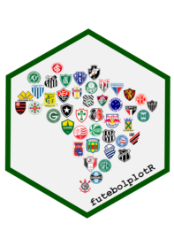
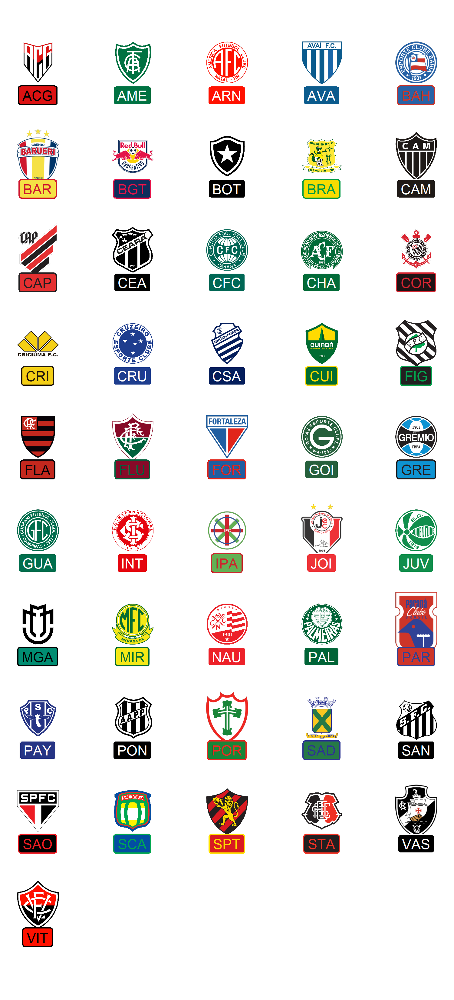

<!-- README.md is generated from README.Rmd. Please edit that file -->

# **futebolplotR** <a href="https://brunomioto.github.io/futebolplotR/"></a>

<!-- badges: start -->

<!-- [](https://CRAN.R-project.org/package=futebolplotR) -->

<!-- badges: end -->

The goal of **futebolplotR** is to provide functions and geoms that help
creating visualization of **Brazilian soccer** related analysis. It
provides a ggplot2 geom that does the heavy lifting of plotting
Brazilian soccer badges in high quality, with correct aspect ratio and
possible transparency.

The **futebolplotR** contains emblems of the teams that have
participated in the Brasileirão Série A soccer league from 2003 to the
present day. Other teams are also welcome!

This package can be used with data from
[brasileirao](https://github.com/williamorim/brasileirao) R package.

Since version 0.1.0, **futebolplotR** requires ggplot2 \>= 4.0.0.

The code for this package was **heavily** based on
[nbaplotR](https://mrcaseb.github.io/nbaplotR/) with minor changes to
support Brazilian soccer team badges.

## Installation

You can install the development version of futebolplotR from
[GitHub](https://github.com/brunomioto/futebolplotR/) with:

``` r
if (!require("pak")) install.packages("pak")
pak::pak("brunomioto/futebolplotR")
```

## Using futebolplotR

The key function in the package is `geom_futebol_badges()` which will
add Brazilian soccer team badges to a ggplot. Here you can see all the
current available teams (currently 46) to plot.

``` r
library(futebolplotR)
library(ggplot2)

team <- futebolplotR::valid_team_names()

n_cols <- 5
n_rows <- ceiling(length(team) / n_cols)

df <- data.frame(
  a = rep(1:n_cols, n_rows)[seq_along(team)],
  b = rep(n_rows:1, each = n_cols)[seq_along(team)],
  teams = team
)

ggplot(df, aes(x = a, y = b)) +
  geom_futebol_badges(aes(team_abbr = teams),
                      width = 0.1) +
  geom_label(aes(label = teams,
                 color = teams,
                 fill = teams),
             linewidth = 0.5,
             nudge_y = -0.35)+
  scale_color_futebol(type = "secondary")+
  scale_fill_futebol(type = "primary")+
  theme_void()+
  theme(
    plot.margin = margin(15,15,15,15,"pt")
  )+
  coord_cartesian(clip = "off")
```



For more information on using the package, check out our [**Getting
Started**](https://brunomioto.github.io/futebolplotR/articles/futebolplotR.html)
article

# Credits

This package was created by [Bruno Mioto](https://github.com/brunomioto)
and [Gabriela Junqueira](https://github.com/junqueiragaabi). We thank
[Sebastian Carl](https://github.com/mrcaseb) for creating the nflplotR
and nbaplotR packages, which were fundamental to the development of
futebolplotR.
